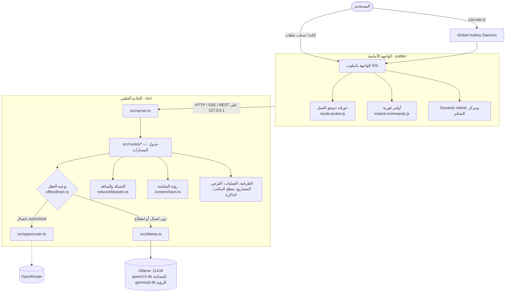

# ARCHITECTURE.md — البنية المعمارية لمشروع «سند (SANAD)»

وثيقة معمارية توضح تفاصيل النظام الداخلي، وتدفق البيانات، ووضعَي العمل (باتصال / دون اتصال)، والتكامل مع Windows 11.
الأرقام الواردة هنا **مقاسة** على جهاز التطوير (i5-11300H، رام 16GB، RTX 3050 بذاكرة 4GB) وتشرح سبب كل اختيار.

> أُزيل الحوار الصوتي بالكامل (النطق والسماع وكلمة التنبيه ومكوّنات `vendor/`) بقرار المستخدم. التفاعل الآن بالكتابة، ولوحة الأوامر، والأوامر الفورية.

---

## 🧭 نظرة معمارية عامة (High-Level Architecture)

**الواجهة:** `public/index.html` يحمل الهيكل وقلب المحادثة (سكربت مضمّن ~1,500 سطر)؛ كل نافذة في ملف مستقل (`*-ui.js` وغيرها) يُحمَّل بعده بترتيب ثابت، و`app-boot.js` أخيراً. الأوامر المحلية في `command-registry.js`.

**الخادم:** `src/server.ts` نقطة تشغيل فقط: طبقة الحماية (`src/http/security.ts`) ← جدول المسارات (`src/http/router.ts` + ملف لكل مجال في `src/routes/`) ← ملفات الواجهة (`src/http/static.ts`).

---

## 🔄 تدفق تنفيذ الطلب (Execution Flow)

1. **الاستلام:** نص مكتوب في صندوق الكتابة أو في Dynamic Island.
2. **الأوامر المحلية أولاً:** `tryHandleSystemIntent` يسلّم النص لسجل الأوامر الموحّد `public/command-registry.js` (`window.sanadCommands`). كل أمر سجل مستقل: `match` على نص موحّد (الهمزات والتاء المربوطة والتشكيل)، و`run` بأدوات تمرّرها الواجهة (`reply`/`progress`/`post`…)، وأمثلة إيجابية وسلبية تُختبر آلياً. أول أمر يطابق يُنفَّذ **دون العقل** (زمن الفهم ≈ 0)؛ وإن فشل جُرّب التالي، وإلا ذهب النص للعقل. أوامر الشبكة (`instant-commands.js`) ومطوّر سند الذاتي مسجّلة فيه كأوامر مفوَّضة.
   - **الحماية من التنفيذ بالخطأ:** أوامر `action`/`danger` (لوحة المفاتيح، الفأرة، القفل، تشغيل البرامج، إنشاء الملفات…) لا تطابق سؤالاً («كيف/هل/لماذا…» أو ينتهي بـ ؟) ولا جملة أطول من 8 كلمات — هذه للعقل. الكتابة بلوحة المفاتيح تحتاج صيغة صريحة («اكتب في الكيبورد …»، «اكتب: …»)، فـ«اكتب لي مقالاً» تذهب للعقل.
3. **العقل:** `POST /api/chat/stream`. يحقن الخادم الذاكرة الدائمة، ويقرّر `decideChatRoute` (في `src/routes/chat.ts`) الوجهة حسب وضع العمل وحالة الاتصال. الرد يُبث عبر SSE.
4. **الأدوات:** `checkAndExecuteModelTools` يسلّم الرد لـ `public/model-tools.js`: يقرأ وسوم `<tool_use><tool_name>…</tool_name><arguments>{JSON}</arguments></tool_use>` خارج كتل الكود فقط، ويتحقق من الأداة (قائمة مسموحة) وحقولها (النوع، المدى، القيم المسموحة، مسارات الملفات)، وينفّذ أول أداة صالحة فقط؛ غير الصالح يُذكر في الرد ولا يُنفَّذ. «احفظ وشغّل» للكود صار زراً بيد المستخدم (`code-run.js`) لا تشغيلاً تلقائياً. الإجراءات الحساسة تمر بـ `public/api-guard.js` الذي يطلب تأكيد المستخدم قبل التنفيذ (ردود النماذج قد تحمل تعليمات محقونة).

---

## 🔌 وضع العمل: باتصال / دون اتصال

**عند فتح سند** تظهر ورقة «كيف يعمل سند الآن؟» (`public/mode-picker.js`) بخيارين، مع حالة كل منهما (الإنترنت متاح؟ كم نموذجاً محلياً جاهزاً؟):

| الخيار | الوضع في الخادم | قائمة النماذج | السلوك |
|---|---|---|---|
| **العمل باتصال** | `auto` | كل النماذج (السحابية + المحلية) | السحابة عند الاتصال؛ العقل المحلي تلقائياً عند الانقطاع أو فشل الشبكة قبل وصول أي نص |
| **العمل دون اتصال** | `offline` | المحلية فقط | المحلي دائماً، ولا يُفحص الاتصال أصلاً (لا طلبات DNS) |

- الاختيار يُرسَل إلى `POST /api/brain/mode {mode}` (قائمة مسموحة: `auto`/`offline`/`cloud`)، فيتقدّم على `SANAD_MODE` حتى إعادة تشغيل الخادم. في «دون اتصال» يُجهَّز النموذج المحلي في الذاكرة بالخلفية (إلا إذا `OLLAMA_WARMUP=false`).
- بعد التبديل تُعاد قائمة النماذج (`window.reloadModels`) وحالة العقل. كل طلب لقائمة النماذج يحمل رقماً، فالرد القديم البطيء (قائمة السحابة) لا يغطي قائمة أحدث.
- في «دون اتصال» يتبدّل سطر أسفل صندوق الكتابة، وتُخفى بطاقة حد طلبات OpenRouter (`body.work-offline`).
- التبديل لاحقاً: شارة الحالة في الشريط العلوي، أو تبويب «الاتصال» في الهاتف، أو «وضع العمل» في الجزيرة، أو لوحة الأوامر (Ctrl+K).
- `SANAD_MODE=auto|offline|cloud` في `.env` يبقى الوضع الافتراضي عند تشغيل الخادم.

**تفاصيل العقل المحلي (`src/offlineBrain.ts`):**
- **فحص الاتصال:** حل اسم `openrouter.ai` مع ذاكرة 30 ثانية. أخطاء HTTP من OpenRouter (401/402/429…) **لا** تُعدّ انقطاعاً.
- **Ollama:** يُشغَّل تلقائياً عند الإقلاع (`ollama serve` منفصلاً)، ويُسخَّن النموذج بنفس البرومبت النظامي المختصر حتى يكون أول رد سريعاً.
- **البرومبت المحلي** (`SANAD_LOCAL_SYSTEM_PROMPT` في `config.ts`): أقصر بكثير من السحابي، مع أمثلة توضيحية، لأن النماذج الصغيرة تلتزم بالتعليمات القصيرة أفضل.
- **كرت الشاشة:** كان معطّلاً بـ `num_gpu: 0`؛ تفعيله رفع السرعة من 4 إلى نحو 71 كلمة/ث، والزمن من 15 ث إلى 0.6 ث (قياس بنموذج 3B).
- **الرؤية دون إنترنت:** `screenVision.ts` يستخدم `gemma3:4b` محلياً عند الانقطاع (حوالي 13 ث لتحليل لقطة).
- **الواجهة لا تطلب أي مورد خارجي:** الخط مستضاف في `public/fonts/` (OFL)؛ و`npm.cmd run offline:check` يفحص ذلك آلياً.
- **ما يحتاج الإنترنت بطبيعته:** البحث في الويب وقراءة الصفحات وعنوان IP العام — تُعيد `offline: true` ورسالة واضحة بدل «لا نتائج».

---

## 🧠 الذاكرة (RAM) — ما يستهلكها فعلاً
| المكوّن | خاصة | مقيمة فعلاً | ملاحظة |
|---|---|---|---|
| مشغّل النموذج `llama-server` (qwen3.5:4b كاملاً على كرت الشاشة) | ~5.6GB | ~1.1GB | معظمها حجز من الذاكرة الافتراضية، لا رام حقيقية |

- **لا تُغيَّر هذه لأنها بلا أثر:** تقليل `num_ctx` من 8192 إلى 4096 وفّر ~130MB من كرت الشاشة فقط؛ ضغط ذاكرة السياق `q8_0` نحو 100MB؛ و`use_mmap=true` **رفع** الرام المقيمة من 1.0 إلى 3.0GB.
- **عند ازدحام الرام** (أقل من 2GB فارغة) يبطؤ أول تحميل للنموذج لأن Windows يبدأ بنقل الذاكرة إلى القرص؛ `offline:check` ينبّه لذلك.
- حذف مكوّنات الصوت وفّر ~0.9GB من القرص، ونحو 1–1.5GB من الرام كانت تشغلها محركات النطق والسماع أثناء الاستخدام.

---

## 🌐 الشبكة والمنافذ — `src/networkMaestro.ts`
- **الفحص السريع:** `netstat -ano` (~35 ملي ث) + أسماء البرامج من `tasklist` بذاكرة 15 ث. فحص منفذ ~0.25 ث بدل 2.3 ث (PowerShell `Get-NetTCPConnection` صار احتياطياً).
- **التحرير الآمن:** قبل إنهاء أي عملية يُجلب اسمها من جديد (لا من الذاكرة) لأن الحماية تعتمد عليه؛ عمليات النظام (`System`، `svchost`، `lsass`…) وخادم سند نفسه محمية، وكل تحرير يمر بتأكيد المستخدم.

---

## 💾 نماذج حفظ البيانات (Persistence Models)

في `data/` (محلياً بصيغة JSON):
- `data/memory.json`: الذاكرة الدائمة للمستخدم.
- `data/actionWorkflows.json`: مسارات العمل المحفوظة.
- `data/tasks.json`: المهام المجدولة.
- `data/free-models.json`: الفهرس الاحتياطي للموديلات السحابية.
- المتصفح (`localStorage`): سجل المحادثات والمظهر وإحصائيات الاستخدام وآخر وضع عمل اختير.

---

## 🛡️ معايير الأمان والاستقرار (Security & Resilience)

1. **سلامة الحذف:** لا أداة تحذف ملفات المستخدم الشخصية؛ التنظيف يستهدف `%TEMP%` والمجلدات المؤقتة فقط.
2. **تأكيد الإجراءات:** كل إجراء حساس صادر من رد نموذج (طرفية، إنهاء عملية، تحرير منفذ، كتابة ملفات…) يمر بنافذة تأكيد في `api-guard.js`.
3. **الخادم محلي فقط** (`127.0.0.1`) برمز جلسة في كوكي HttpOnly ورأس `X-Sanad-Request`.
4. **عزل العمليات:** البرامج المستقلة تُشغَّل منفصلة (`detached` + `unref`).
5. **مدخلات مقيّدة:** وضع العمل من قائمة مسموحة؛ أرقام المنافذ ضمن 1–65535؛ أسماء المضيفين للـ Ping بنمط آمن.
6. **CORS محدود:** يُسمح به لمجلد `public/fonts/` فقط (لتحميل الخط داخل إطارات الإضافات المعزولة).
7. **المعاينة المعزولة:** معاينة المشاريع والإضافات في إطارات `sandbox`.

---

## 🧪 الفحص والاختبار
- `npm.cmd run typecheck`: بعد أي تعديل في `src/`.
- `npm.cmd test`: فحص الأنواع + اختبارات المسارات والحماية (`tests/`) + 37 اختبار أوامر فورية + 191 اختبار سجل الأوامر (أمثلة كل أمر، وجمل محادثة يجب ألا تنفّذ أي إجراء).
- `npm.cmd run test:ui`: الواجهة في Edge دون نافذة، ومنها ظهور ورقة «وضع العمل» عند الفتح.
- `npm.cmd run test:e2e`: سند دون إنترنت (محاكاة)، ومنها «دون اتصال» ← النماذج المحلية فقط.
- `npm.cmd run offline:check`: جاهزية العقل المحلي، والذاكرة المتاحة، وخلوّ الواجهة من الموارد الخارجية.
