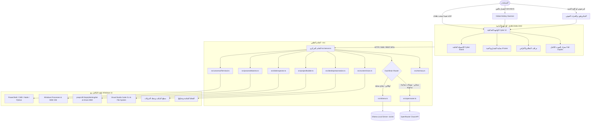

# ARCHITECTURE.md — البنية المعمارية لمشروع «سند (SANAD)»

وثيقة معمارية شاملة توضح تفاصيل النظام الداخلي، تدفق البيانات، والتكامل مع نظام التشغيل Windows 11.

---

## 🧭 نظرة معمارية عامة (High-Level Architecture)

---

## 🔄 تدفق تنفيذ الأوامر الذكية (Execution Flow)

1. **الاستلام والتحليل (Turn Input):**
   - يلتقط المتصفح رسالة المستخدم (صوتياً عبر كلمة التنبيه أو كتابة أو سحب ملف).
   - تُرسل الرسالة إلى `POST /api/chat/stream`.
2. **المعالجة بالذكاء الاصطناعي (Model Reasoning):**
   - يقوم السيرفر بحقن الذاكرة الدائمة (`src/memory.ts`) في البرومت النظامي.
   - إذا تم اختيار نموذج محلي، يتدفق الطلب إلى `src/ollama.ts`، وإذا كان سحابياً إلى `src/openrouter.ts`.
   - يتم بث الرد للمتصفح عبر Server-Sent Events (SSE) في الوقت الحقيقي.
3. **اكتشاف وتنفيذ الأدوات (Tool Execution & Interception):**
   - يفحص المحلل في المتصفح أو الخادم نية تنفيذ الأدوات (`checkAndExecuteModelTools`):
     - تشغيل برامج: `/api/system/action` (`launch-any-app`)
     - تحرير الرام: `/api/system/optimize-ram`
     - بناء مشروع: `/api/project/build` وفتح المعاينة فوراً
     - طرفية: `/api/terminal/universal`
4. **التأكيد البصري والصوتي (Feedback & Speech):**
   - تشغيل المؤثر الصوتي السايبراني المناسب (`playSciFiSound`).
   - نطق ملخص الإنجاز بالعربية الفصيحة في حال تفعيل وضع الـ Full-Duplex Voice.
   - تحديث الكبسولة العائمة **Dynamic Island** بالحالة الراهنة.

---

## 💾 نماذج حفظ البيانات (Persistence Models)

جميع البيانات تُحفظ محلياً بصيغة JSON آمنة ومحمية من الحذف العرضي في مجلد `data/`:
- `data/memories.json`: الذاكرة الذاتية الدائمة للمستخدم واهتماماته وإعداداته.
- `data/workflows.json`: سير العمل المتكرر والمحفوظ للاستدعاء السريع.
- `data/tasks.json`: المهام المجدولة اليومية وتوقيتاتها وحالتها.
- `data/free-models.json`: الفهرس الاحتياطي للموديلات الذكية ليعمل دون الحاجة للاستعلام الخارجي.
- المتصفح (`localStorage`):
  - `opencode.chat.v1`: سجل المحادثات والرسائل السابقة.
  - `opencode.theme`: الوضع البصري (داكن / فاتح).
  - `opencode.usage.v1`: إحصائيات استهلاك التوكنز والرموز.

---

## 🛡️ معايير الأمان والاستقرار (Security & Resilience)

1. **سلامة الحذف (Safe Deletion Policy):**
   - لا تقوم أي أداة في «سند» بحذف ملفات شخصية للمستخدم.
   - وظائف التنظيف (`clean-disk`) تستهدف فقط `%TEMP%` ومجلدات الـ CrashDumps المؤقتة بعد التحقق من مسارها.
2. **عزل العمليات (Non-blocking Process Isolation):**
   - تشغيل التطبيقات المستقلة يتم بفصل معالجات الإدخال والإخراج (`detached: true, stdio: "ignore"` مع `.unref()`).
3. **أمان الـ iFrame (Sandboxed Preview):**
   - المعاينة الحية للمشاريع تستخدم `sandbox="allow-scripts allow-same-origin allow-forms allow-popups"` لتأمين بيئة تشغيل أكواد المستخدم ومنع أي تعارض مع الواجهة الرئيسية.
