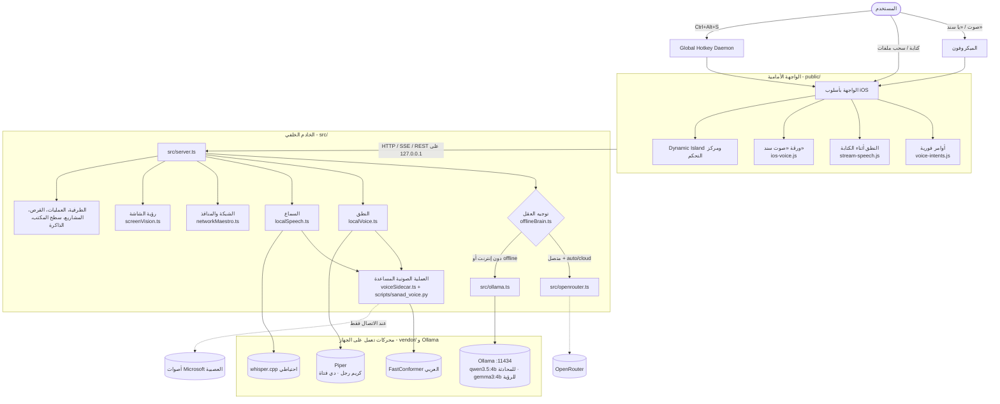

# ARCHITECTURE.md — البنية المعمارية لمشروع «سند (SANAD)»

وثيقة معمارية توضح تفاصيل النظام الداخلي، وتدفق البيانات، والعمل دون إنترنت، ومسار الصوت، والتكامل مع Windows 11.
الأرقام الواردة هنا **مقاسة** على جهاز التطوير (i5-11300H، رام 16GB، RTX 3050 بذاكرة 4GB) وتشرح سبب كل اختيار.

---

## 🧭 نظرة معمارية عامة (High-Level Architecture)



---

## 🔄 تدفق تنفيذ الطلب (Execution Flow)

1. **الاستلام:** كتابة، أو صوت يُحوَّل إلى نص (انظر «مسار الصوت»). النص يمر بـ `normalizeArabicSpeech` الذي يصحّح كلمة التنبيه («يا سندي/يا سناد» ← «يا سند») والأرقام المنطوقة («ثلاثة آلاف» ← 3000).
2. **الأوامر الفورية أولاً:** `tryHandleSystemIntent` يجرّب الموجّهات المحلية بالترتيب، وأولها `window.sanadIntents` (الشبكة والمنافذ). إن طابق الأمر نُفّذ مباشرة **دون العقل** (زمن الفهم ≈ 0)، وإلا ذهب للعقل.
3. **العقل:** `POST /api/chat/stream`. يحقن الخادم الذاكرة الدائمة، ويقرّر `decideChatRoute` (في `server.ts`) الوجهة حسب `SANAD_MODE` وحالة الاتصال (انظر «العمل دون إنترنت»). الرد يُبث عبر SSE.
4. **الأدوات:** `checkAndExecuteModelTools` يلتقط وسوم `<tool_use>` من رد النموذج. الإجراءات الحساسة تمر بـ `public/api-guard.js` الذي يطلب تأكيد المستخدم قبل التنفيذ (ردود النماذج قد تحمل تعليمات محقونة).
5. **الرد الصوتي:** في الوضع الصوتي ينطق `stream-speech.js` كل جملة **فور اكتمالها أثناء البث**، ثم يعود الميكروفون للاستماع.

---

## 🔌 العمل دون إنترنت (Offline Brain)

`src/offlineBrain.ts` + `decideChatRoute` في `src/server.ts`:

| `SANAD_MODE` | السلوك |
|---|---|
| `auto` (الافتراضي) | السحابة عند الاتصال؛ العقل المحلي عند الانقطاع أو عند فشل الشبكة قبل وصول أي نص |
| `offline` | المحلي دائماً، ولا يُفحص الاتصال أصلاً (لا طلبات DNS) |
| `cloud` | السحابة فقط |

- **فحص الاتصال:** حل اسم `openrouter.ai` مع ذاكرة 30 ثانية. أخطاء HTTP من OpenRouter (401/402/429…) **لا** تُعدّ انقطاعاً.
- **Ollama:** يُشغَّل تلقائياً عند الإقلاع (`ollama serve` منفصلاً)، ويُسخَّن النموذج بنفس البرومبت النظامي المختصر حتى يكون أول رد سريعاً.
- **البرومبت المحلي** (`SANAD_LOCAL_SYSTEM_PROMPT` في `config.ts`): أقصر بكثير من السحابي، مع أمثلة توضيحية، لأن النماذج الصغيرة تلتزم بالتعليمات القصيرة أفضل.
- **كرت الشاشة:** كان معطّلاً بـ `num_gpu: 0`؛ تفعيله رفع السرعة من 4 إلى نحو 71 كلمة/ث، والزمن من 15 ث إلى 0.6 ث (قياس بنموذج 3B).
- **الرؤية دون إنترنت:** `screenVision.ts` يستخدم `gemma3:4b` محلياً عند الانقطاع (حوالي 13 ث لتحليل لقطة).
- **الواجهة لا تطلب أي مورد خارجي:** الخط مستضاف في `public/fonts/` (OFL)؛ و`npm.cmd run offline:check` يفحص ذلك آلياً.
- **ما يحتاج الإنترنت بطبيعته:** البحث في الويب وقراءة الصفحات وعنوان IP العام — تُعيد `offline: true` ورسالة واضحة بدل «لا نتائج».

---

## 🎙️ مسار الصوت (Voice Pipeline)

```
الميكروفون ─► VAD في المتصفح (يرسل الكلام فقط، صمت 0.65 ث لنهاية الجملة)
           ─► WAV 16kHz ─► POST /api/voice/transcribe
           ─► FastConformer (افتراضي) أو whisper.cpp (احتياطي)
           ─► تصحيح النص ─► أمر فوري أو العقل
           ─► النطق: ذاكرة مؤقتة ◄ صوت عصبي طبيعي (متصل) ◄ Piper (دون إنترنت)
```

### السماع — `src/localSpeech.ts`
| المحرك | الزمن | الدقة (عيّنات عربية) | ملاحظة |
|---|---|---|---|
| **FastConformer** (NVIDIA، CC-BY-4.0) | **~0.16 ث** | **97%** | الافتراضي، يعمل في العملية المساعدة |
| whisper.cpp small | ~1.9 ث | 92% | احتياطي؛ مع تلميح مفردات `prompt` |

- يُحمَّل المحرك مسبقاً عند فتح الميكروفون (`POST /api/voice/warm`).
- إن تأخر التحميل **لا** يُشغَّل whisper فوقه (محرك ثانٍ يضاعف الذاكرة)، بل تظهر رسالة «ما زال يُحمَّل».
- **درس مهم (Windows):** العملية المساعدة تقرأ الطلبات من stdin في خيط ينتظر، وفي Windows **تعلق تهيئة أي مكتبة DLL** (مثل ONNX Runtime) في خيط آخر ما دامت قراءة متزامنة معلّقة على نفس القناة — كان التحميل يعلق أكثر من 60–90 ث حتى يصل سطر جديد. الحل: كل المكتبات الأصلية تُستورد في الخيط الرئيسي **قبل** بدء القراءة (`_preload_native_libraries`)، فصار التحميل الأول ~1–2 ث. لا تُضِف استيراداً كسولاً لمكتبة أصلية داخل خيط في هذه العملية.

### النطق — `src/localVoice.ts`
1. **الذاكرة المؤقتة** `data/voice-cache/` (حد 300MB، يُحذف الأقدم): كل جملة نُطقت بالصوت الطبيعي تُعاد فوراً (~10 ملي ث) **حتى دون إنترنت**. `npm.cmd run voice:warm` يحفظ العبارات الشائعة مسبقاً.
2. **الصوت العصبي الطبيعي** (عند الاتصال): أصوات Microsoft العربية عبر `edge-tts` في العملية المساعدة. وضوحها 97–99%، وأول صوت 1–3.5 ث. واجهة غير رسمية: إن توقفت يتحول سند تلقائياً للصوت المحلي.
3. **Piper** (دون إنترنت): عملية دائمة لكل صوت (`--json-input`) بأولوية أعلى على المعالج. ~0.6–1 ث للجملة وحده، و~1.6 ث أثناء عمل العقل.

**الأصوات المحلية:** كريم (رجل، وضوح 97%) ودي (فتاة، CC-BY-NC-ND، وضوح 91%).

**بدائل جُرّبت ورُفضت (قياسات حقيقية):**
| البديل | السبب |
|---|---|
| Chatterbox Multilingual (أكثر الأصوات المفتوحة طبيعية) | 9–36 ث للجملة، وملأ ذاكرة كرت الشاشة (3.9 من 4GB) وتعطّل؛ ولا يتسع مع العقل |
| Piper «ميرو» | وضوح 84%، ينطق «سند» خطأ |
| Piper «كريم low» | أسرع 20% لكن جودة أقل ولا نسخة للفتاة |

### العملية الصوتية المساعدة — `src/voiceSidecar.ts` + `scripts/sanad_voice.py`
عملية Python واحدة دائمة في `vendor/py`، بروتوكول JSON سطراً بسطر (`ping` / `tts` / `stt` / `warm`)، تُشغَّل عند أول حاجة وتُطفأ بعد 10 دقائق خمول. طلبات النطق متوازية (لتحضير الجملة التالية أثناء تشغيل الحالية)، والتعرّف واحد تلو الآخر.

### الواجهة
- `public/stream-speech.js`: يقسم الرد المتدفق إلى جمل، ويتخطى الكود ووسوم الأدوات، ويحضّر صوت الجملة التالية مسبقاً، ويتوقف فوراً عند المقاطعة.
- `public/ios-voice.js`: رجل/فتاة، اختيار الصوت الطبيعي مع معاينة، معاينة الصوت المحلي، ومحرك السماع.

---

## 🧠 الذاكرة (RAM) — ما يستهلكها فعلاً
قياس الذاكرة **الخاصة** لكل مكوّن أثناء الاستخدام (جهاز 16GB):

| المكوّن | خاصة | مقيمة فعلاً | ملاحظة |
|---|---|---|---|
| مشغّل النموذج `llama-server` (qwen3.5:4b كاملاً على كرت الشاشة) | ~5.6GB | ~1.1GB | معظمها حجز من الذاكرة الافتراضية، لا رام حقيقية |
| whisper.cpp | ~850MB | ~330MB | |
| العملية المساعدة مع FastConformer | ~780MB | ~540MB | ~310MB دون النموذج |
| Piper (لكل صوت) | ~125MB | ~125MB | |

**قرارات مبنية على القياس:**
- **محرك سماع واحد فقط في الذاكرة:** تغيير الإعداد يُطفئ whisper أو يفرّغ FastConformer فوراً (`applySttEngine`) — كان الاثنان معاً ~1.6GB.
- **صوت محلي واحد دافئ:** صوت الجنس الآخر (بعد معاينة أو تبديل) يُحرَّر بعد دقيقة بدل عشر.
- **لا تُغيَّر هذه لأنها بلا أثر:** تقليل `num_ctx` من 8192 إلى 4096 وفّر ~130MB من كرت الشاشة فقط؛ ضغط ذاكرة السياق `q8_0` نحو 100MB؛ و`use_mmap=true` **رفع** الرام المقيمة من 1.0 إلى 3.0GB.
- **عند ازدحام الرام** (أقل من 2GB فارغة) يبطؤ أول تحميل للنماذج لأن Windows يبدأ بنقل الذاكرة إلى القرص؛ `offline:check` ينبّه لذلك. (تأخيرات السماع الطويلة التي نُسبت سابقاً للذاكرة كان سببها الحقيقي تعليق stdin في العملية المساعدة — انظر «مسار الصوت».)

---

## 🌐 الشبكة والمنافذ — `src/networkMaestro.ts`
- **الفحص السريع:** `netstat -ano` (~35 ملي ث) + أسماء البرامج من `tasklist` بذاكرة 15 ث. فحص منفذ ~0.25 ث بدل 2.3 ث (PowerShell `Get-NetTCPConnection` صار احتياطياً).
- **التحرير الآمن:** قبل إنهاء أي عملية يُجلب اسمها من جديد (لا من الذاكرة) لأن الحماية تعتمد عليه؛ عمليات النظام (`System`، `svchost`، `lsass`…) وخادم سند نفسه محمية، وكل تحرير يمر بتأكيد المستخدم.

---

## 💾 نماذج حفظ البيانات (Persistence Models)

في `data/` (محلياً بصيغة JSON):
- `data/memory.json`: الذاكرة الدائمة للمستخدم.
- `data/actionWorkflows.json`: مسارات العمل المحفوظة.
- `data/tasks.json`: المهام المجدولة.
- `data/free-models.json`: الفهرس الاحتياطي للموديلات السحابية.
- `data/voice-settings.json`: إعدادات الصوت (مستثنى من git؛ قيم من قوائم مسموحة فقط).
- `data/voice-cache/`: الصوت الطبيعي المحفوظ (مستثنى من git).
- المتصفح (`localStorage`): سجل المحادثات والمظهر وإحصائيات الاستخدام.

**المكوّنات الثنائية** في `vendor/` (مستثناة من git، ~0.9GB): Piper والأصوات، FastConformer، whisper.cpp، بيئة Python. تُجهَّز وتُتحقق بصماتها بـ `scripts/voice-setup.ps1` (ضمن `npm.cmd run offline:setup`).

---

## 🛡️ معايير الأمان والاستقرار (Security & Resilience)

1. **سلامة الحذف:** لا أداة تحذف ملفات المستخدم الشخصية؛ التنظيف يستهدف `%TEMP%` والمجلدات المؤقتة فقط.
2. **تأكيد الإجراءات:** كل إجراء حساس صادر من رد نموذج أو أمر صوتي (طرفية، إنهاء عملية، تحرير منفذ، كتابة ملفات…) يمر بنافذة تأكيد في `api-guard.js`.
3. **الخادم محلي فقط** (`127.0.0.1`) برمز جلسة في كوكي HttpOnly ورأس `X-Sanad-Request`.
4. **عزل العمليات:** البرامج المستقلة تُشغَّل منفصلة (`detached` + `unref`)؛ محركات الصوت تُطفأ عند الخمول ولا تبقى عالقة.
5. **مدخلات مقيّدة:** أسماء الأصوات ومحرك السماع من قوائم مسموحة؛ أرقام المنافذ ضمن 1–65535؛ أسماء المضيفين للـ Ping بنمط آمن؛ ملفات الصوت يُتحقق أنها WAV.
6. **CORS محدود:** يُسمح به لمجلد `public/fonts/` فقط (لتحميل الخط داخل إطارات الإضافات المعزولة).
7. **المعاينة المعزولة:** معاينة المشاريع والإضافات في إطارات `sandbox`.

---

## 🧪 الفحص والاختبار
- `npm.cmd run typecheck`: بعد أي تعديل في `src/`.
- `npm.cmd run test:voice`: 37 اختبار أوامر (منها جمل يجب ألا تُعامَل كأوامر) + 4 اختبارات للنطق أثناء الكتابة.
- `npm.cmd run offline:check`: جاهزية 19 مكوّناً، والذاكرة المتاحة، وخلوّ الواجهة من الموارد الخارجية.
